# Architecture Guide

How Scribe is put together: what each file does, who talks to whom, and where to change things.
All diagrams are Mermaid; they render on GitHub and in VS Code (Markdown Preview Mermaid Support extension).

## 1. The 30-second explanation

Scribe is a Notepad-style editor in Qt 6 / C++20, split into **three static libraries** plus an exe:

| Layer | Library | Knows about | Job |
|---|---|---|---|
| `src/core` | `scribe_core` | Qt Core only (no widgets) | Pure logic: file bytes ⇄ text, encoding, line endings, the command list |
| `src/editor` | `scribe_editor` | core + Qt Widgets | Widgets: one text editor per tab, the tab row |
| `src/app` | `scribe_ui` (+ `scribe.exe`) | everything | Window, menus, dialogs, and the "what happens when the user clicks Save" rules |

**Dependency rule: arrows only point downward.** `core` never includes anything from `editor` or `app`.
That is why `core` can be unit tested with GoogleTest and no window.

Three ideas hold the design together:

1. **Commands.** Every action (`file.save`, `tab.close`...) is a `Command` in a `CommandRegistry`. Menus only look up a command id and run it.
2. **Callbacks instead of hard-wiring.** `FileDialogs` is a struct of `std::function`s (so tests replace dialogs), and `EditorTabs::CloseGuard` is a callback (so the tab row can ask "may I close this?" without knowing about dialogs).
3. **The editor widget owns the live text.** While typing, `QPlainTextEdit` is the truth (so undo/redo work). The `Document` only gets the text when saving, and supplies it when loading.

## 2. Layer / component diagram

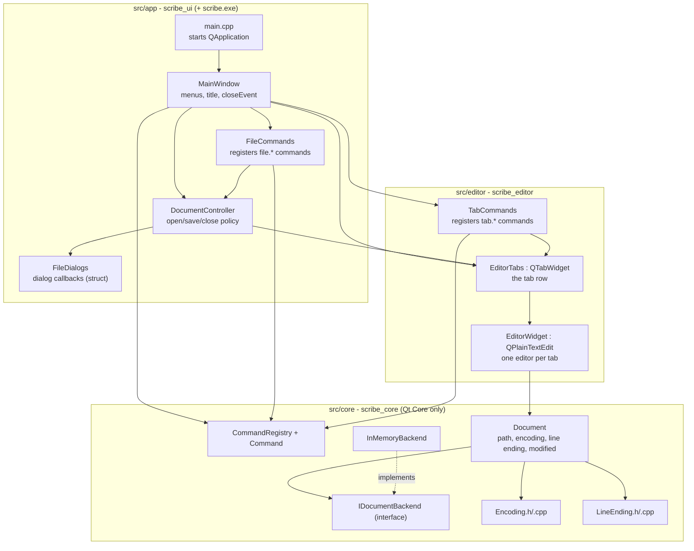

CMake mirrors this: `scribe_ui → scribe_editor → scribe_core` (see `src/*/CMakeLists.txt`).

## 3. Class diagram

```mermaid
classDiagram
    direction TB

    class IDocumentBackend {
        <<interface>>
        +length() qsizetype
        +lineCount() qsizetype
        +text() QString
        +text(pos, count) QString
        +line(index) QString
        +setText(text)
        +insert(pos, text) bool
        +remove(pos, count) bool
    }
    class InMemoryBackend {
        -QString m_text
    }
    IDocumentBackend <|-- InMemoryBackend

    class Document {
        -unique_ptr~IDocumentBackend~ m_backend
        -QString m_filePath
        -EncodingInfo m_encoding
        -LineEnding m_lineEnding
        -bool m_modified
        +backend() IDocumentBackend
        +filePath() QString
        +isModified() bool
        +setEncoding(info)
        +setLineEnding(le)
        +setText(text)
        +insert(pos, text) bool
        +remove(pos, count) bool
        +load(path) IoResult
        +save() IoResult
        +saveAs(path) IoResult
    }
    Document *-- IDocumentBackend : owns

    class IoResult {
        <<struct>>
        +DocumentError error
        +QString detail
        +ok() bool
    }
    class DocumentError {
        <<enum>>
        None
        CannotRead
        InvalidEncoding
        CannotEncode
        CannotWrite
    }
    class EncodingInfo {
        <<struct>>
        +Encoding encoding
        +bool hasBom
    }
    class Encoding {
        <<enum>>
        Utf8
        Utf16Le
        Utf16Be
        Ansi
    }
    class LineEnding {
        <<enum>>
        Crlf
        Lf
        Cr
    }
    Document ..> IoResult : returns
    IoResult --> DocumentError
    Document *-- EncodingInfo
    EncodingInfo --> Encoding
    Document --> LineEnding

    class Command {
        <<struct>>
        +QString id
        +QString title
        +QString shortcut
        +function callback
        +bool enabled
    }
    class CommandRegistry {
        -vector~Command~ m_commands
        -QHash m_indexById
        +registerCommand(cmd) bool
        +find(id) Command*
        +run(id) bool
        +setEnabled(id, on) bool
        +commands()
    }
    CommandRegistry *-- Command

    class EditorWidget {
        -Document m_fileDocument
        +fileDocument() Document
        +isModified() bool
        +displayName() QString
        +newFile()
        +openFile(path) IoResult
        +saveFile() IoResult
        +saveFileAs(path) IoResult
        +setEncoding(info)
        +setLineEnding(le)
        -syncTextToDocument()
        -markSaved()
        «signal» stateChanged()
    }
    class QPlainTextEdit
    QPlainTextEdit <|-- EditorWidget
    EditorWidget *-- Document

    class EditorTabs {
        -CloseGuard m_closeGuard
        +currentEditor() EditorWidget
        +editorAt(i) EditorWidget
        +addEditor() EditorWidget
        +indexOfPath(path) int
        +openFile(path) IoResult
        +setCloseGuard(guard)
        +closeTab(i) bool
        +closeOtherTabs(i) bool
        +closeAllTabs() bool
        +nextTab()
        +previousTab()
        «signal» currentEditorStateChanged()
        -adopt(editor)
        -refreshTab(editor)
        -confirmClose(page) bool
    }
    class QTabWidget
    QTabWidget <|-- EditorTabs
    EditorTabs o-- EditorWidget : one per tab

    class TabCommands {
        +kClose, kCloseOthers, kCloseAll
        +kNext, kPrevious
        +registerIn(registry, tabs)$
    }
    TabCommands ..> CommandRegistry : registers into
    TabCommands ..> EditorTabs : callbacks call

    class FileDialogs {
        <<struct>>
        +function chooseOpenPath
        +function chooseSavePath
        +function showError
        +function confirmDiscard
    }
    class UnsavedChoice {
        <<enum>>
        Save
        Discard
        Cancel
    }
    FileDialogs ..> UnsavedChoice

    class DocumentController {
        -EditorTabs& m_tabs
        -FileDialogs m_dialogs
        -QWidget* m_dialogParent
        +newFile()
        +openFile()
        +saveFile()
        +saveFileAs()
        -save(editor) bool
        -saveAs(editor) bool
        -confirmClose(editor) bool
        -showIoError(result, path, editor)
    }
    DocumentController --> EditorTabs : uses + installs CloseGuard
    DocumentController *-- FileDialogs

    class FileCommands {
        +kNew, kOpen, kSave, kSaveAs, kExit
        +registerIn(registry, controller, window)$
    }
    FileCommands ..> CommandRegistry : registers into
    FileCommands ..> DocumentController : callbacks call

    class MainWindow {
        -CommandRegistry m_commands
        -EditorTabs* m_tabs
        -unique_ptr~DocumentController~ m_controller
        +commands()
        +editor() EditorWidget
        +tabCount() int
        #closeEvent(event)
        -registerCommands()
        -buildMenus()
        -addCommandAction(menu, id) QAction
        -updateTitle()
    }
    class QMainWindow
    QMainWindow <|-- MainWindow
    MainWindow *-- CommandRegistry
    MainWindow *-- DocumentController
    MainWindow o-- EditorTabs : central widget
```

## 4. File-by-file guide

### `src/core` (no widgets, fully unit-testable)

| File | Role | Talks to |
|---|---|---|
| `LineEnding.h/.cpp` | `enum LineEnding {Crlf, Lf, Cr}`; `detectLineEnding` (most frequent wins, tie → fallback CRLF), `convertLineEndings` (rewrites all breaks to one style), names for the status bar. | Used by `Document` |
| `Encoding.h/.cpp` | `enum Encoding {Utf8, Utf16Le, Utf16Be, Ansi}`, `EncodingInfo{encoding, hasBom}`. `detectEncoding` (BOM → UTF-16 guess → strict UTF-8 check → ANSI), `decode`, `encode` (returns `nullopt` if a char can't be represented). | Used by `Document` |
| `IDocumentBackend.h` | Interface for text storage (`insert/remove/text/line/...`). Always `\n` line breaks, UTF-16 positions. Exists so a memory-mapped backend for huge files can be added later (Phase 7). | Implemented by `InMemoryBackend` |
| `InMemoryBackend.h/.cpp` | The only backend today: one `QString`. | - |
| `Document.h/.cpp` | One file's *state*: backend text + path + encoding + line ending + `modified`. `load()` reads bytes → detects encoding → decodes → **rejects the file if re-encoding doesn't reproduce the same bytes** → normalises line breaks to `\n`. `saveAs()` converts back to the file's line ending, encodes, writes through `QSaveFile` (atomic: temp file + rename). Returns `IoResult` (never throws, never shows UI). | Owns a backend; uses Encoding, LineEnding |
| `CommandRegistry.h/.cpp` | `Command{id, title, shortcut, callback, enabled}` and the registry (`registerCommand`, `find`, `run`, `setEnabled`). Rejects empty id / empty callback / duplicate id. | Filled by `FileCommands`, `TabCommands`; read by `MainWindow` |

### `src/editor` (Qt Widgets, no dialogs, no menus)

| File | Role | Talks to |
|---|---|---|
| `EditorWidget.h/.cpp` | A `QPlainTextEdit` + a `core::Document`. Open: `Document::load` then `setPlainText`. Save: `syncTextToDocument()` (copy widget text into Document **only if different**), then `Document::save/saveAs`, then `markSaved()`. Emits `stateChanged` when path/modified/encoding/line-ending change. `isModified()` = widget modified **or** Document modified. | Owns a `Document` |
| `EditorTabs.h/.cpp` | The tab row (`QTabWidget`). Always ≥ 1 tab. Smart `openFile` (already open → switch; untouched Untitled → reuse; else load into a *detached* editor, add tab only on success). Close methods go left→right and stop at the first refusal by the **close guard**. Tab title = name + `" *"` when modified. Middle-click closes (event filter). Re-emits `currentEditorStateChanged` for the active tab only. | Owns `EditorWidget`s (Qt parent ownership) |
| `TabCommands.h/.cpp` | Registers `tab.close / closeOthers / closeAll / next / previous` with their shortcuts; each callback calls an `EditorTabs` method. | `CommandRegistry`, `EditorTabs` |

### `src/app` (glue + user interaction)

| File | Role | Talks to |
|---|---|---|
| `main.cpp` | Creates `QApplication`, sets name/version/icon, shows `MainWindow`, runs the event loop. | `MainWindow` |
| `FileDialogs.h/.cpp` | `FileDialogs` = struct of 4 callbacks (open path, save path, show error, confirm discard) + `UnsavedChoice {Save, Discard, Cancel}`. `defaultFileDialogs()` fills them with real `QFileDialog`/`QMessageBox`. Tests pass scripted fakes so nothing blocks. | Used by `DocumentController`, `MainWindow` |
| `DocumentController.h/.cpp` | **The policy brain.** Implements new/open/save/saveAs, turns `IoResult` errors into user messages (`showIoError`), and installs itself as `EditorTabs`' close guard: modified tab → ask → Save (a cancelled/failed save keeps the tab) / Discard / Cancel. Not a `QObject`. | `EditorTabs`, `EditorWidget`, `FileDialogs` |
| `FileCommands.h/.cpp` | Registers `file.new/open/save/saveAs/exit`. Callbacks call the controller; Exit calls `window.close()`. | `CommandRegistry`, `DocumentController` |
| `MainWindow.h/.cpp` | Builds `EditorTabs` as the central widget, creates the controller, registers commands, builds File/View menus **from the registry**, keeps the window title in sync (`name[*] - Scribe`), and routes `closeEvent` through `closeAllTabs()`. | everything in app + editor + core |

### Build / support files

| File | Role |
|---|---|
| `CMakeLists.txt` (root) | C++20, Qt 6.5+, AUTOMOC/AUTORCC, adds `src/core`, `src/editor`, `src/app`, `tests`. |
| `src/*/CMakeLists.txt` | One static library per layer; `src/app` also builds `scribe.exe` and runs `windeployqt`. `PROJECT_VERSION` is injected as a compile definition. |
| `CMakePresets.json`, `vcpkg.json` | `debug`/`release` Ninja presets; vcpkg supplies `gtest` (and `nlohmann-json`, not yet used in code). |
| `resources/` | `resources.qrc` (icon), `scribe.rc` (Windows exe icon), icon images. |
| `.clang-format`, `.clang-tidy` | Style / static analysis, enforced in CI. |
| `.github/workflows/ci.yml`, `scripts/run-ci-checks-locally.ps1` | CI (debug + release build, test, format, tidy) and the local equivalent. |
| `docs/` | Plan (`02`), standards (`03`), workflow (`04`), manual tests (`05`), this guide (`06`). |

### `tests/`

| Test | Covers | Framework |
|---|---|---|
| `LineEndingTest`, `EncodingTest`, `InMemoryBackendTest`, `DocumentTest`, `CommandRegistryTest` | `core` | GoogleTest (`scribe_gtests`) |
| `EditorWidgetTest`, `EditorTabsTest`, `TabCommandsTest` | `editor` | Qt Test |
| `DocumentControllerTest`, `FileDialogsTest`, `MainWindowTest` | `app` (with fake `FileDialogs`) | Qt Test |
| `SmokeGTest`, `SmokeQtTest` | toolchain sanity | both |

## 5. Sequence diagrams

### 5.1 Startup and wiring

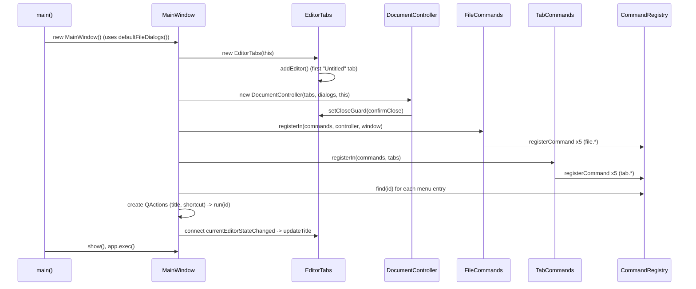

### 5.2 Save (Ctrl+S) on a file that already has a path

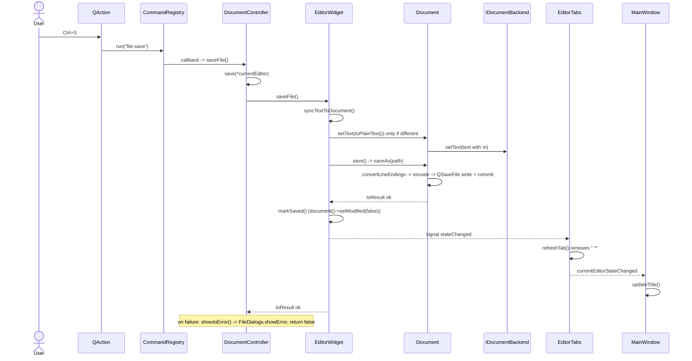

### 5.3 Open a file (Ctrl+O)

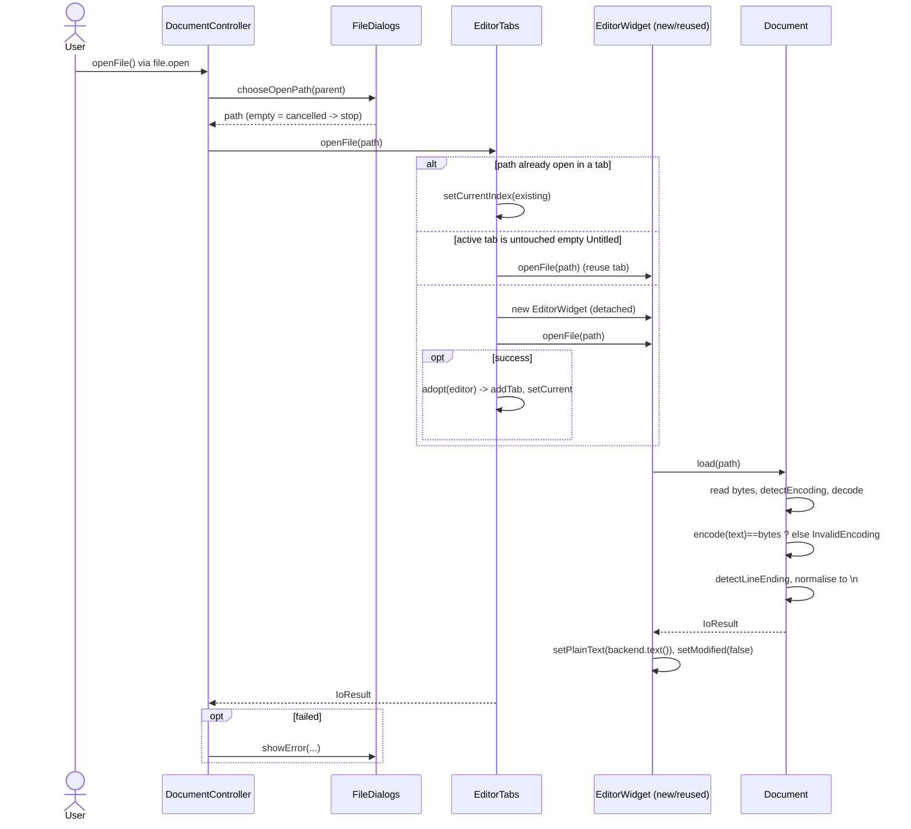

### 5.4 Close a modified tab (the close guard)

Same path for the tab "x", middle-click, Ctrl+W, Close Others, Close All and closing the window.

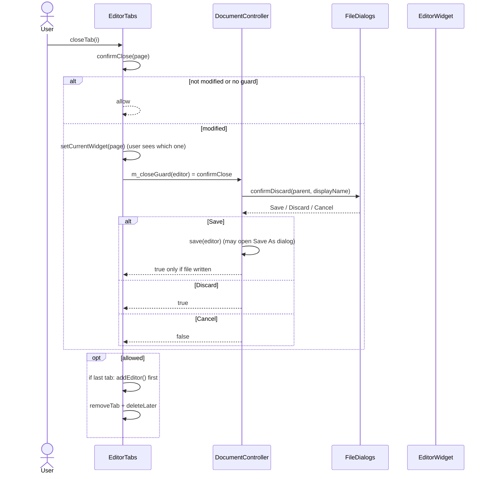

### 5.5 Closing the window

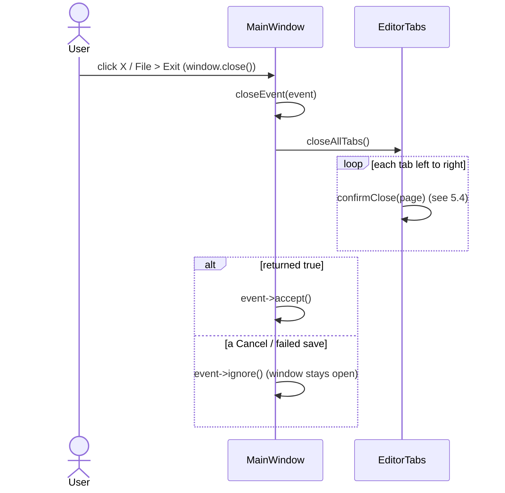

## 6. State diagrams

### 6.1 "Modified" flag of an editor

`isModified() = widget.document()->isModified() || fileDocument.isModified()`

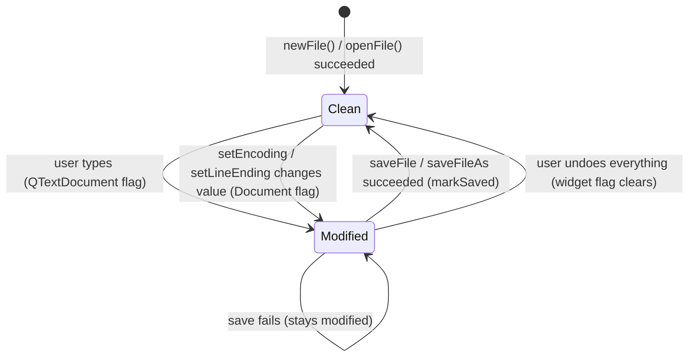

### 6.2 Tab lifecycle

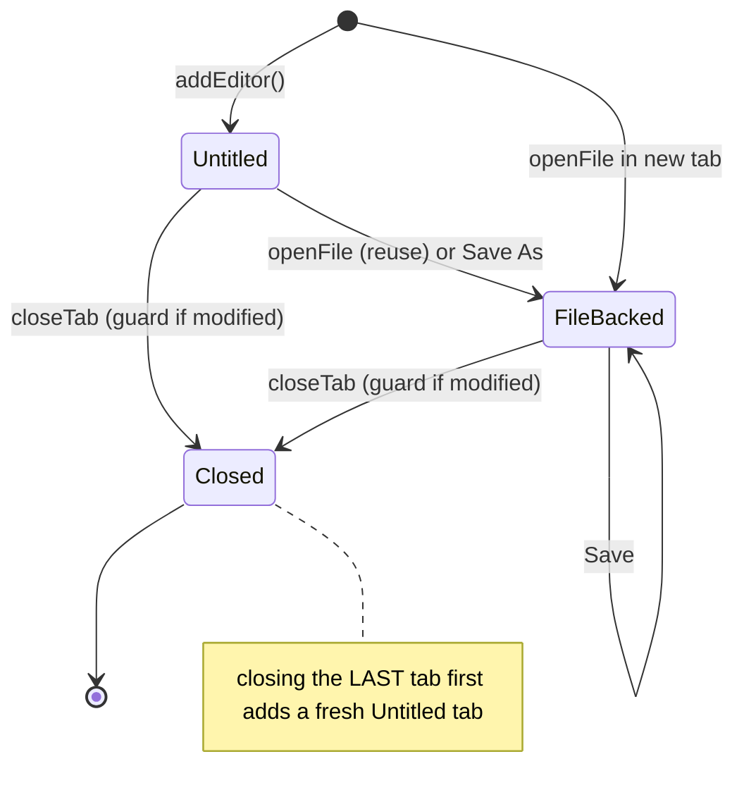

## 7. Data flow of a file (bytes ↔ text)

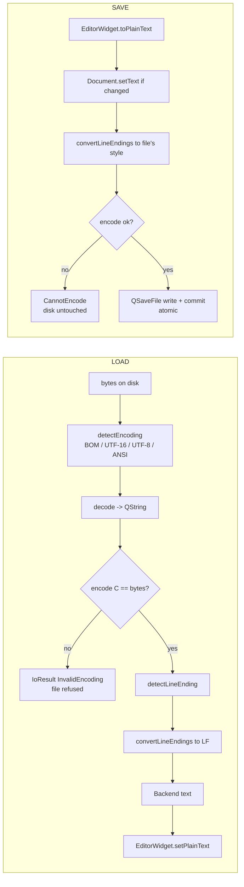

## 8. Signals and ownership (Qt specifics)

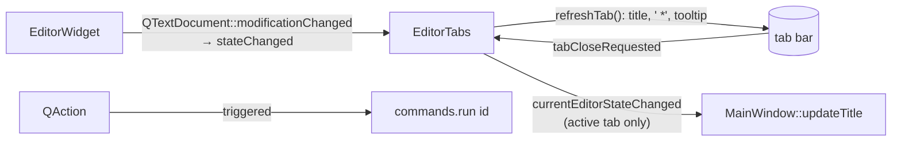

Ownership: `MainWindow` (Qt parent) → `EditorTabs` → `EditorWidget`s. `MainWindow` also owns `CommandRegistry` and `unique_ptr<DocumentController>`. The controller is declared **last** in `MainWindow` so it is destroyed **first** (its destructor clears the guard that captured `this`). `Command` callbacks hold *references* to the controller/tabs/window, which must outlive `registry.run()`.

## 9. "I want to change X" cheat sheet

| Goal | Where | Notes |
|---|---|---|
| Add a menu action (e.g. Find) | New `XxxCommands` class (copy `TabCommands`), call `registerIn` in `MainWindow::registerCommands`, add `addCommandAction(menu, Xxx::kId)` in `buildMenus` | Add `.cpp/.h` to the library's CMakeLists |
| Change a shortcut / label | The `Command{...}` line in `FileCommands.cpp` / `TabCommands.cpp` | `&` = menu mnemonic |
| Change dialog text / buttons / file filter | `FileDialogs.cpp` (`fileFilter`, `askAboutUnsavedChanges`) | |
| Change an error message | `DocumentController::showIoError` | |
| Change what "unsaved changes" does | `DocumentController::confirmClose` | |
| Change how tabs open/close/look | `EditorTabs.cpp` (`openFile`, `closeTab`, `refreshTab`) | |
| Support a new encoding | `Encoding` enum + `converterFor`, `bomFor`, `detectEncoding`, `encodingName` in `Encoding.cpp`; add tests | |
| Support a huge-file backend | New class implementing `IDocumentBackend`; pass to `Document(std::unique_ptr<...>)` | `EditorWidget` currently constructs `Document()` (in-memory) |
| Change window title format | `MainWindow::updateTitle` | |
| Add a status bar (encoding / line ending) | Add widgets in `MainWindow`, refresh in the slot connected to `currentEditorStateChanged`; use `encodingName`, `lineEndingName`, `EditorWidget::setEncoding/setLineEnding` | Those setters exist but no UI uses them yet |
| Add a test | GoogleTest: `tests/CMakeLists.txt` list. Qt Test: `scribe_add_qt_test(name file lib)` | Pass fake `FileDialogs` to `MainWindow(FileDialogs, parent)` |

## 10. Things worth knowing / gotchas

- `EditorWidget::fileDocument().backend().text()` is **stale** between load/save and typing; never read it for the current text, use `toPlainText()`.
- `EditorWidget::syncTextToDocument` compares texts instead of trusting flags. A failed save of an unchanged file must not look modified, because `Document::setText` always sets modified.
- Files with mixed line endings are saved with the most common one. Files that fail the encode round trip cannot be opened (by design, no silent data change).
- `DocumentController` and `FileCommands` are not in a namespace and not `QObject`s; they use `Q_DECLARE_TR_FUNCTIONS` for `tr()`.
- `setEncoding` / `setLineEnding` are implemented and tested but not yet reachable from the UI.
- `nlohmann-json` is in `vcpkg.json` but unused so far (planned for later phases).
